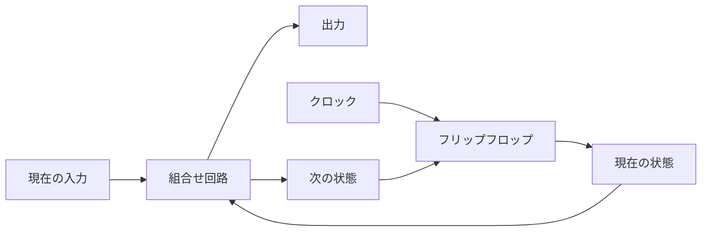

# 02. デジタル回路 — 0/1 を電圧と時間で考える

デジタル回路の `0` と `1` は抽象的な記号ですが、実体は電圧範囲です。ソフトウェアの `bool` やビット演算を、ゲート・レジスタ・配線の動きとして捉えます。

## 1. 論理値と論理ゲート

`H`（High）と `L`（Low）がどの電圧範囲かは MCU ごとに異なります。データシートの `VIL`（Low と認識する最大入力電圧）と `VIH`（High と認識する最小入力電圧）を確認します。中間の電圧は値が保証されず、特に CMOS 入力では避けます。

| A | B | AND `A·B` | OR `A+B` | XOR `A⊕B` | NAND `¬(A·B)` |
| :-: | :-: | :-: | :-: | :-: | :-: |
| 0 | 0 | 0 | 0 | 0 | 1 |
| 0 | 1 | 0 | 1 | 1 | 1 |
| 1 | 0 | 0 | 1 | 1 | 1 |
| 1 | 1 | 1 | 1 | 0 | 0 |

- `NOT` は 0/1 を反転する。
- `AND` は「両方が真」、`OR` は「少なくとも一方が真」。
- `XOR` は「異なるとき真」。ビット反転やパリティに使われる。
- ド・モルガンの法則: `¬(A·B) = ¬A + ¬B`、`¬(A+B) = ¬A·¬B`。否定を含む条件式や回路図を読み替える助けになる。

## 2. 組合せ回路と順序回路



| 種類 | 出力が決まるもの | 例 |
| --- | --- | --- |
| 組合せ回路 | 現在の入力だけ | 加算器、デコーダ、マルチプレクサ |
| 順序回路 | 現在の入力と過去の状態 | フリップフロップ、カウンタ、状態機械 |

フリップフロップはクロックのエッジで値を記憶します。CPU のレジスタ、タイマのカウンタ、通信回路のシフトレジスタは、この「状態を保持する」仕組みに基づきます。

## 3. GPIO: プルアップ、プルダウン、押しボタン

入力ピンを何にもつながないと、ノイズで H/L が揺れる**フローティング**状態になります。外部または MCU 内蔵の抵抗で既定値を決めます。

```text
プルアップ + ボタン（押すと 0）

VDD ──[10 kΩ]──┬── GPIO input
               │
             [SW]
               │
GND ───────────┘
```

ボタンを押していないと H、押すと GND につながり L です。これは **active-low** と呼ばれ、回路図の信号名に `/RESET` や `RESET_N` のように表記されることがあります。内部プルアップを有効にするだけで外部抵抗が不要な場合もありますが、値・起動直後の状態・消費電流は仕様を確認します。

## 4. 時間の問題: チャタリング、セットアップ／ホールド、メタ安定

- **チャタリング**: 機械スイッチは押した直後に 0/1 を何度も往復する。一定時間のソフトウェア判定、RC 回路、専用 IC で除去する。
- **セットアップ時間**: クロックの前に入力を安定させる必要がある時間。
- **ホールド時間**: クロックの後にも入力を保持すべき時間。
- **メタ安定**: 非同期信号をクロック境界で取り込むと、0/1 が一時的に決まらない状態。通常は 2 段のフリップフロップ同期器などで確率を下げる。

外部ボタン、別クロックのセンサ、UART 受信などは CPU クロックに対して非同期です。「割り込みで読めば安全」とは限らず、信号の同期・バッファ・プロトコルが必要です。

## 5. ソフトウェアとの対応

| ハードウェアの考え方 | C / 組込みでの姿 |
| --- | --- |
| AND / OR / XOR / NOT | `&` / `|` / `^` / `~`（ビット演算） |
| レジスタの 1 bit | 有効化フラグ、状態、割り込み要因 |
| マスク | `reg = (reg & ~MASK) | value` のようなビット更新 |
| クロック | CPU 実行、タイマ、通信の基準時間 |

`&&` と `&` は異なります。前者は真偽値と短絡評価、後者は各ビットの論理積です。周辺レジスタ操作では通常 `&`、`|`、`^`、`~` を使います。

## セルフチェック

1. `A = 1`、`B = 0` のとき、`A XOR B` は何か。
2. ボタン入力にプルアップ抵抗を置く目的は何か。
3. `reg |= (1U << 3)` は第 3 ビットに何をするか（最下位を bit 0 とする）。
4. ある信号が別のクロック領域から来るとき、なぜ 1 回読めば十分とは限らないか。

<details>
<summary>答え</summary>

1. `1`。  
2. 未押下時の入力を H に固定し、フローティングを防ぐ。  
3. bit 3 を 1 にする。他のビットは保持する。  
4. 取り込みのタイミングでメタ安定や取りこぼしが起こり得るため。同期・バッファ・プロトコルを検討する。
</details>
