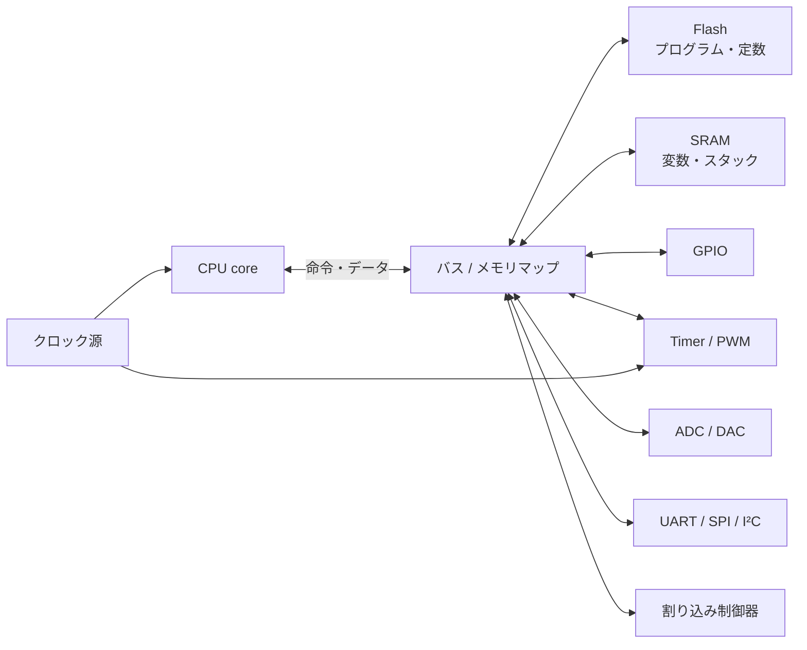

# 03. マイコンのしくみ — CPU と周辺回路を一つのシステムとして見る

マイコン（MCU）は、CPU、メモリ、GPIO、タイマ、通信回路などを 1 チップに集積したものです。Android のアプリ層より下にある OS・ドライバの責務を、より直接的に扱うイメージです。ただし MCU ではメモリ量、電力、時間、物理ピンがすべて制約になります。

## 1. 全体像



同じアドレス空間に Flash、RAM、周辺レジスタが並ぶ **メモリマップト I/O** が一般的です。CPU からは「アドレスの読み書き」でも、GPIO にはピンを切り替える、UART には送信を始める、といった物理的な効果があります。

## 2. 起動から `main` まで

1. リセット解除後、CPU はリセットベクタのアドレスから実行を開始する。
2. スタートアップコードがスタックを設定し、初期値を RAM に配置し、BSS（ゼロ初期化領域）を 0 で埋める。
3. クロック、電源、ピン多重化などを初期化する。
4. `main()` が実行され、通常は無限ループまたは RTOS のスケジューラへ進む。

「グローバル変数がなぜ最初から 0 か」「`main` の前に何が動くか」は、リンカスクリプト、スタートアップコード、ベクタテーブルを読むと理解が深まります。名称・配置は CPU アーキテクチャや SDK によって異なります。

## 3. 周辺回路の代表例

| 周辺回路 | 役割 | よくある用途 |
| --- | --- | --- |
| GPIO | 汎用入出力、ピン機能の切替 | LED、ボタン、チップ選択 |
| Timer | クロックを数える | 周期処理、タイムアウト、入力キャプチャ |
| PWM | デューティ比を変える矩形波 | LED 調光、モータ制御、サーボ |
| ADC | アナログ電圧を数値に変換 | 温度、電池電圧、可変抵抗 |
| UART | 非同期シリアル通信 | ログ、PC 接続、GPS |
| SPI | クロック付き高速同期通信 | センサ、Flash、表示器 |
| I²C | アドレス付き 2 線式通信 | センサ、RTC、設定 IC |
| Watchdog | 規定時間内に給餌がなければリセット | ハング復帰 |
| DMA | CPU を介さずデータ転送 | ADC / UART の連続転送 |

PWM のデューティ比は「1 周期のうち H の割合」です。`3.3 V` の PWM を低速フィルタ後に測ると、50% なら概ね `1.65 V` に近い平均値になりますが、これは真のアナログ出力ではなく、負荷・周波数・フィルタに依存します。

## 4. 割り込みと並行性

```text
通常の処理:  main loop ────────┬───────────────┬──
                                │ timer event   │ UART event
割り込み:                      ISR 実行 → 復帰  ISR 実行 → 復帰
```

割り込みは、イベント発生時に現在の処理を一時中断して ISR（Interrupt Service Routine）を実行する仕組みです。ISR では次を守ります。

- 短く終える。重い計算、待ち、動的メモリ確保、ブロッキング I/O は避ける。
- ハードウェアの割り込み要因を仕様どおりにクリアする。
- メイン処理との共有データは競合する。`volatile` は最適化を抑えるだけで、複数操作を原子的にはしない。
- 必要ならクリティカルセクション、原子操作、リングバッファ、RTOS の ISR 対応 API を使う。

## 5. レジスタ操作と `volatile`

周辺レジスタは値がハードウェアで変わるため、ベンダーのヘッダでは通常 `volatile` を通してアクセスします。

```c
/* 概念例: ビット 3 をセットする。実際の名前は MCU ごとに異なる。 */
PERIPH->ENABLE |= (1U << 3);
```

ただし読み出し・変更・書き込み（read-modify-write）の間に割り込みやハードウェア更新が入ることがあります。MCU が `SET` / `CLEAR` / `TOGGLE` 専用レジスタを持つなら、そちらを使うほうが安全な場合があります。ビットの意味、書込み 1 でクリアか、予約ビット、アクセス幅は必ずリファレンスマニュアルで確認します。

## 6. Android 開発経験からの橋渡し

| Android で慣れた概念 | 組込みで対応する視点 |
| --- | --- |
| UI / イベントコールバック | GPIO・UART・タイマ割り込み。実行時間の上限がより厳しい |
| スレッド | main loop、ISR、RTOS タスク。共有データを明示的に守る |
| ログ | UART、SWO、RTT。出力自体が時間を消費する |
| デバッグ | ブレークポイントに加え、電圧・波形・消費電流・レジスタを見る |
| 権限や API の契約 | データシートの電気的定格・レジスタ仕様・通信プロトコル |

## セルフチェック

1. Flash と SRAM は、一般に何を保持するか。
2. GPIO の設定レジスタを `volatile` として扱う理由は何か。
3. ISR を短く保つべき理由を 1 つ説明できるか。
4. `volatile` だけでは共有カウンタの `count++` が安全にならないのはなぜか。

<details>
<summary>答え</summary>

1. Flash はプログラムや定数、SRAM は実行中の変数・スタック。  
2. ハードウェアによって値が変化し、アクセス自体に副作用があり得るため、コンパイラが読み書きを省略・統合しないようにする。  
3. 他の割り込みの遅延、イベントの取りこぼし、リアルタイム性の悪化を防ぐため。  
4. 読み出し、加算、書き戻しが複数の操作で、その間に別の実行主体が値を変え得るため。
</details>
